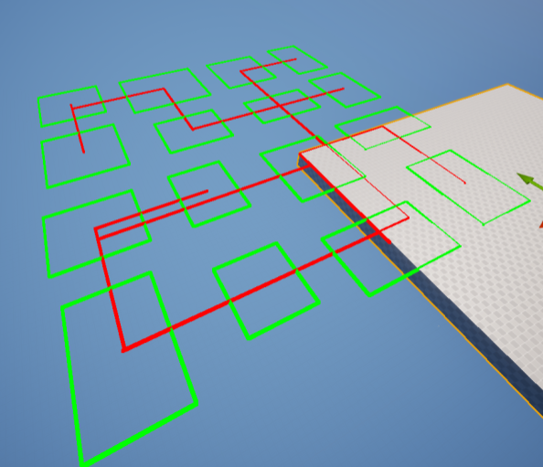
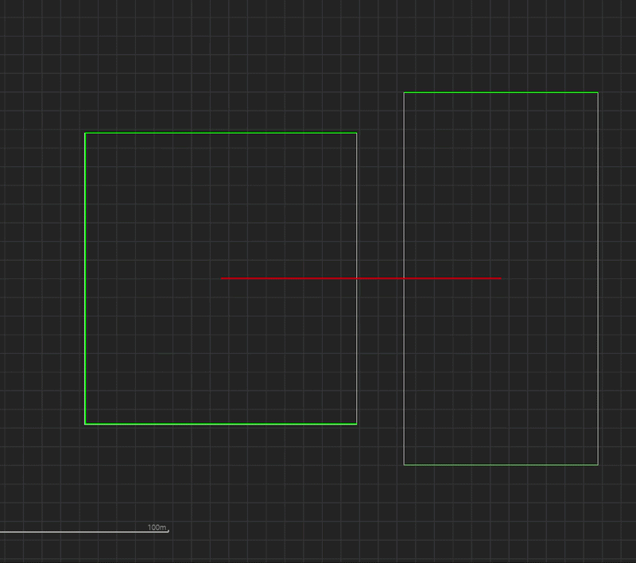
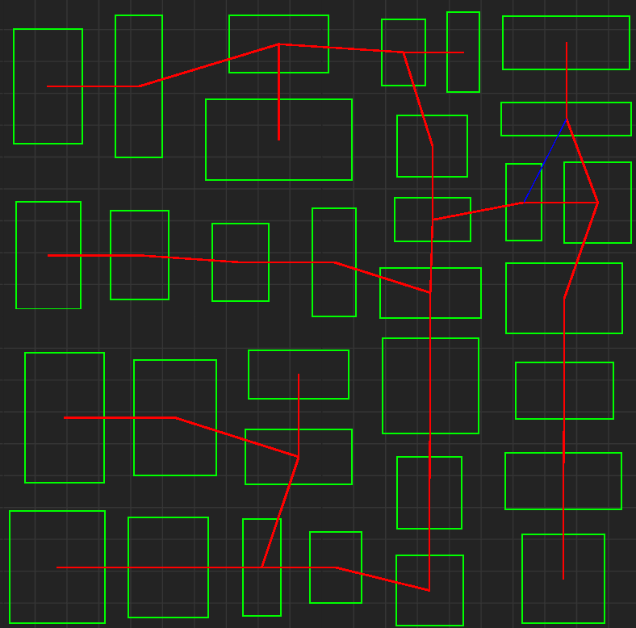
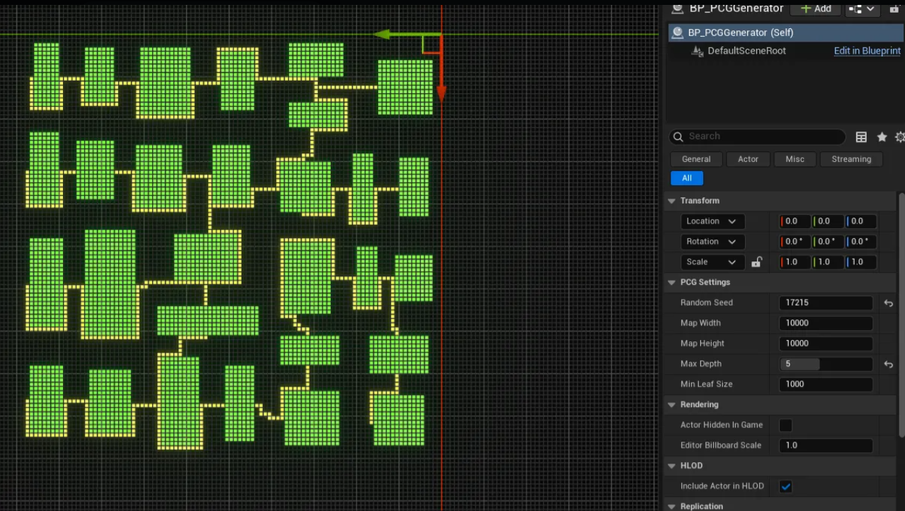
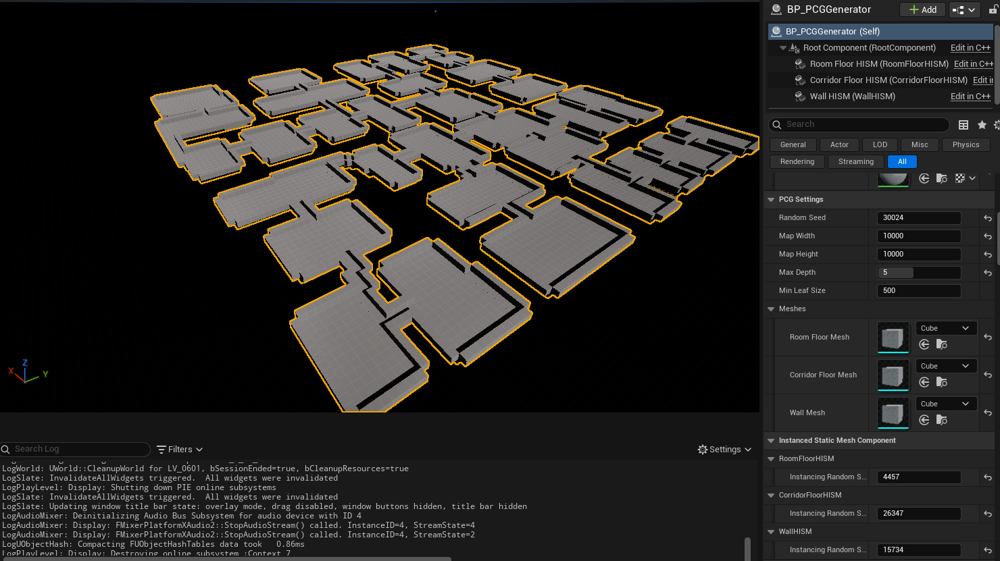

지난 3월, C++ 콘솔 환경에서 BSP 공간 분할과 데이터 구조를 테스트했다. 이번에는 해당 구조체를 언리얼 환경으로 이식하고, 단순 트리 구조였던 복도 연결을 MST를 이용해 그래프로 연결해보았다.

이어서 A*로 타일 맵을 생성하고, HISM으로 실제 3D 맵을 렌더링하는 과정까지 정리했다.

## 1. 언리얼 엔진 이식 및 MST 기반 그래프 생성

### 1.1. 언리얼 C++ 메모리 및 난수 엔진 이식

이전 C++ 콘솔 프로젝트의 RAII패턴(스마트 포인터), 결정론 보장, 구조체를 언리얼 환경에 맞게 수정해서 이식해야한다.

RAII 패턴/언리얼 GC 
- `UObject` GC 대신, 언리얼 Core 라이브러리(`TArray` `TUniquePtr`)를 활용해 데이터 계층의 메모리를 직접 제어 가능하게 설계 
  - `std::unique_ptr` -> `TUniquePtr`   
  - `std::vector` -> `TArray`   

결정론 보장
- C++의 메르센 트위스터 방식에서 언리얼이 제공하는 난수 구조체로 교체 (더 가벼움!)
- 이제 재귀 함수가 호출될때마다 난수 엔진을 재생성하지 않고, 진입점(`OnConstruction`)에서 `FRandomStream`을 Seed로 초기화하고 참조로 넘긴다.
  - `std::mt19937` -> `FRandomStream`

네임스페이스 충돌 해결
- UE 라이브러리에 `FEdge`와 충돌이 발생하여 간선 구조체의 이름을 수정했다.
  - `FEdge` -> `FRoomEdge`


### 1.2. OnConstruction과 DrawDebug를 활용한 데이터 시각화

정상적으로 로직이 이식되었는지 확인하기 위해, `DrawDebug` 함수를 만들었다.

`APCGGenerator` 액터의 `OnConstruction` 함수를 오버라이드하여, 에디터 디테일 패널의 변수를 바꾸면 뷰포트의 맵 형태가 실시간으로 수정되도록 하였다.

### 1.3. BSP 통로의 한계 & 그래프 도입



기존 BSP 트리 구조만으로 방을 연결하면, 몇가지 거슬리는 점이 생긴다.
1. 물리적으로 바로 옆에 있는 방이라도, 트리상 멀리 떨어져 있다면 빙 돌아서 가야한다.
2. 사이클이 없어, 무조건 한번 왔던 길로만 되돌아 갈 수 있다.
   
이를 해결하기 위해, 방과 방 사이를 트리 계층과 무관하게 최단 거리로 잇는 MST를 도입했다.

### 1.4. Union-Find와 Kruskal 기반 MST 구현

가장 먼저 두 방이 이미 연결되었는지 판별하여 사이클을 막아주는 분리 집합 클래스 `FUnionFind`를 구현했다. 이때 탐색 최적화를 위해 경로 압축(Path Compression)을 적용하여 `Find` 연산 시간을 $O(\alpha(N))$으로 줄였다.

백준에서 문제를 풀때와는 다르게 Union by Rank 최적화는 생략하였다.

```cpp
struct FUnionFind
{
    TMap<FBSPNode*, FBSPNode*> Parent;

    // 경로 압축(Path Compression)이 적용된 Find
    FBSPNode* Find(FBSPNode* Node)
    {
        if (Parent[Node] == Node) return Node;
        return Parent[Node] = Find(Parent[Node]); 
    }
    // ... Union 함수 생략
};
```

이후 모든 말단 노드(Room) 간의 거리를 계산하여 정렬한 뒤, 크루스칼로 MST를 추출했다.

### 1.5. 순환로 생성

MST로 생성한 그래프는 사이클이 없어, BSP와 마찬가지로 왔던길로만 되돌아 갈 수 있다. 따라서 크루스칼 알고리즘 진행 중에 사이클을 형성하여 버려지는 간선 중 15%를 무작위(`FRandomStream`)로 부활시켜 맵에 Loop를 추가하였다.

단, 맵의 끝과 끝에 노드가 다이렉트로 연결되는 교차 간선을 막기위해, `MaxLoopDistance` (맵 전체 폭의 15%) 거리 제한을 두었다.

```cpp
if (DSU.Union(Edge.NodeA, Edge.NodeB))
{
    // 사이클이 없으면 메인 뼈대 (빨간선)
    Corridors.Emplace(X1, Y1, X2, Y2, false);
}
else
{
    // 사이클이 발생하더라도, 거리가 짧은 간선은 15% 확률로 Loop로 부활 (파란선)
    if (Edge.Distance < MaxLoopDistance && RNG.FRand() < 0.15f)
    {
        Corridors.Emplace(X1, Y1, X2, Y2, true); 
    }
}
```

### 1.6. MST 그래프 시각화



> 위 이미지는 107번 시드로, 빨간선은 메인 뼈대 파란선은 Loop이다.

상세한 코드는 [깃허브 링크](https://github.com/heparidayo/UnrealPCG)에서 확인 가능하다.    


다음으로는 그래프를 기반으로 실제 물리적 배치를 위한 배열 최적화와 A* 길찾기를 구현한다.

## 2. 2D Grid 메모리 최적화 및 A* 기반 타일 맵 생성

앞서 언리얼 엔진으로 데이터 구조체를 이식하고 MST를 활용하여 방과 방을 잇는 논리적 그래프(선)를 시각화했다. 하지만 선은 캐릭터가 걸어 다닐 수 있는 물리적 공간이 아니다.

이제 100m x 100m의 공간을 1m 크기의 타일들로 쪼개어 메모리에 올리고, A* 알고리즘을 통해 논리적 선을 실제 타일 복도로 변환하는 과정을 구현해보았다.

### 2.1. 논리적 선(Vector)에서 물리적 면(Grid)로

기존에 구한 데이터는 두 방의 중심점을 잇는 좌표로, 이를 실제 던전으로 렌더링하려면 타일 맵 데이터로 변환해야 한다.

가장 먼저 타일의 상태를 정의할 열거형을 만들었다.
- `Wall`: 파내지 않은 꽉 찬 벽
- `RoomFloor`: 방의 바닥
- `CorridorFloor`: 복도의 바닥

### 2.2. 1차원 배열을 활용한 2D Grid 메모리 최적화

2D 타일 맵을 구현할 때 흔히 `TArray<TArray<uint8>>` 형태의 2차원 배열을 떠올리기 쉽다. 하지만 이는 메모리가 연속적으로 할당되지 않아 CPU 캐시 지역성(Cache Locality)이 떨어져 병목의 원인이 된다.

대신 1차원 배열을 2차원처럼 다루는 방식으로 메모리 파편화를 방지했다.

```cpp
// 2D 맵 데이터를 담을 1차원 배열 (캐시 최적화)
TArray<ETileType> GridMap;
int32 GridSizeX;
int32 GridSizeY;

// 2D(X,Y) -> 1D 인덱스로 변환하는 인라인 함수
// inline대신 FORCEINLINE 사용 (MSVC의 __forceinline 등으로 강제로 인라인화할 것을 명령)
FORCEINLINE int32 Get1DIndex(int32 X, int32 Y) const
{
    return Y * GridSizeX + X;
}
```

생성된 모든 Room 데이터의 영역을 1m 단위 타일 좌표로 변환하고, 이 1차원 `GridMap` 배열의 해당 인덱스들을 `ETileType::RoomFloor`로 덮어씌워 방을 파냈다.

### 2.3. A* 길찾기를 이용한 복도 생성

방을 모두 파낸 후, 앞서 구한 MST `Corridors` 배열을 순회하며 A*로 탐색했다.

이때 매번 노드를 `new`로 할당하면 GC 부하와 메모리 릭이 발생할 수 있으므로, 언리얼의 `TUniquePtr`와 `TMap`을 컨테이너로 메모리 소유권을 관리했다. 또한, 성능이 중요한 닫힌 목록(`ClosedList`)은 2차원 맵 크기와 동일한 1차원 `TArray<bool>`로 할당하여 탐색시 O(1) 시간복잡도를 유도한다.

### 2.4. A* 가중치를 이용한 우회 경로 (Soft Constraint)

단순하게 A* 알고리즘 적용 시 최단 거리를 찾기 위해 복도가 방을 항상 뚫고 직진해버린다. 방의 모양이 훼손되지 않도록 탐색 중 바로 옆 타일이 `RoomFloor`일 경우 가중치(현재, +500점)를 부여하는 부드러운 제약(Soft Constraint) 방식을 적용했다.

```cpp
int32 MoveCost = 10; // 평지 이동 기본 비용

// [가중치] 방을 피해서 돌아가도록 가중치 부여
if (GridMap[NeighborIndex] == ETileType::RoomFloor)
{
    // 도착지가 남의 방 내부에 있는 경우가 아니라면 가중치
    if (!(NeighborX == TargetX && NeighborY == TargetY))
    {
        MoveCost += 500;
    }
}

int32 NewG = CurrentNode->G + MoveCost;
```

위 결과로 A* 알고리즘은 가중치를 받으면서 방을 뚫는 경우는 거의 없어지고, 대부분 방의 외각 벽을 따라 우회하는 경로를 찾게 된다.

### 2.5. 타일 맵 시각화


> 위 이미지는 타일 렌더링 결과로, 초록색 타일은 방(Room)을, 노란색 타일은 방을 우회하며 이어진 복도(A* Corridor)를 나타낸다.

기존에 호출하던 `DrawDebugLine` 기반의 렌더링 함수를 지우고, `GridMap` 전체를 순회하며 바닥 타일에 `DrawDebugSolidBox`를 그리는 함수로 교체했다.



이어서 `HISM(Hierarchical Instanced Static Mesh)` 컴포넌트를 활용해 위 사진과 같이 3D 스태틱 메쉬로 교체하고, Draw Call 최적화에 대해 알아보자.

## 3. HISM 기반 3D 렌더링 및 은면 제거

앞서 2D Grid 배열을 활용하여 방+복도 데이터를 메모리에 올렸다. 하지만 지금까지 뷰포트에 띄운 `DrawDebugSolidBox`는 실제 게임에서 사용할 수 없는 에디터 전용 시각화 도구다.

이제 이 n만 개의 데이터 배열을 바탕으로 실제 3D Static Mesh를 월드에 배치하되, Draw Call 문제를 방지하기 위해 `HISM` 컴포넌트와 은면 제거 알고리즘을 도입하여 렌더링을 최적화해 보았다.

### 3.1. Actor 스폰의 Draw Call 병목

100m x 100m 크기의 맵은 1m 단위 타일(여기서는 기본 제공되는 Cube) 10,000개로 이루어진다. 만약 이 타일마다 일반적인 `AStaticMeshActor`를 1만 개 스폰한다면 어떻게 될까?

CPU는 GPU에게 "1번 큐브 그려라", "2번 큐브 그려라" 하며 1만 번의 렌더링 명령(Draw Call)을 내리게 되고, 이는 CPU 병목 현상으로 이어지며 컴퓨터의 성능과 맵 크기에 따라 엔진이 튕길 수 있다.

### 3.2. HISM을 활용한 하드웨어 인스턴싱

언리얼에는 `HISM(Hierarchical Instanced Static Mesh)` 컴포넌트로 위 문제를 해결 가능하다. HISM은 지금처럼 동일한 메쉬 1만개를 그릴 때, 메쉬 원본 데이터 1개 + 1만개의 좌표 (Trnasform 배열)만 GPU로 넘겨 Draw Call 을 1회만 발생시키는 최적화 기법이다.

- `ISM`과 달리 계층적(Hierarchical) 구조를 가져, 시야 밖의 인스턴스를 통째로 Frustum Culling하거나 거리별 LOD 적용이 가능하다는 장점이 있어 거대 맵 생성에 유용하다.

### 3.3. 에디터 타임 메모리 관리 (`ClearInstances`)

PCG 툴은 에디터의 디테일 패널에서 Seed 값을 변경(`OnConstruction`)할 때마다 맵을 실시간으로 다시 생성한다. 이때 기존 메쉬 데이터를 지우지 않고 인스턴스를 계속 추가하면 에디터의 메모리가 쌓인다.

이를 방지하기 위해 렌더링 루프 시작 전, 이전 맵의 찌꺼기 데이터를 확실하게 비워주는 생명주기(Lifecycle) 관리를 적용했다.

```cpp
// 에디터 블루프린트에서 설정한 메쉬 할당 및 기존 인스턴스 초기화
RoomFloorHISM->SetStaticMesh(RoomFloorMesh);
RoomFloorHISM->ClearInstances();

// 복도 및 벽 HISM도 동일하게 ClearInstances() 호출...
```

### 3.4. 인접 타일 검사를 통한 은면 제거 (Culling)

1만 개의 타일 중, 플레이어가 걸어 다니는 방과 복도를 제외한 7~8천 개의 잉여 타일은 그냥 두툼한 벽으로 남는다. 이 벽 타일마다 모두 메쉬를 생성하면 보이지 않는 맵 외곽과 땅속까지 모두 렌더링되는 낭비가 발생한다.

```cpp
bool bShouldRenderWall = false;

// 4방향 탐색
for (int i = 0; i < 4; ++i)
{
    int32 nx = X + Dx[i];
    int32 ny = Y + Dy[i];

    if (IsValidGridPosition(nx, ny))
    {
        int32 nIndex = Get1DIndex(nx, ny);
        // 내 주변에 방이나 복도(바닥)가 있는가?
        if (GridMap[nIndex] != ETileType::Wall)
        {
            bShouldRenderWall = true; // 노출된 벽이므로 렌더링 승인
            break;
        }
    }
}

// 렌더링 승인이 떨어진 벽만 Z축으로 올려서 HISM에 추가
if (bShouldRenderWall)
{
    FTransform WallTransform(FRotator::ZeroRotator, Position + FVector(0, 0, TileSize), FVector(1.0f));
    WallHISM->AddInstance(WallTransform);
}
```

플레이어에게 노출되는 벽만 렌더링 하도록 4방향을 검사해 렌더링을 승인해주는 은면 제거 (Hidden Surface Removal) 로직을 추가했다.


### 3.5. 결과 시각화 및 다음 목표

> 위 이미지는 1M Cube 메쉬가 HISM으로 생성된 결과이다. 언리얼 콘솔로 `stat rhi` 확인 결과, 1만 개의 공간을 렌더링할때 DrawPrimitive Calls가 3회(방, 복도, 벽)만 실행되고 60프레임 이상을 안정적으로 유지한다. 지하에서 맵을 올려다보면 내부 벽면만 생성되고 맵 외곽의 불필요한 메쉬는 Culling 된 것을 확인할 수 있다.

이제 최적화된 3D 렌더링 뼈대가 완성되었다. 다음에는 벽변과 바닥에 비트마스킹, 푸아송 디스크 샘플링 등으로 프롭을 자연스럽게 배치해볼 것이다.

---

